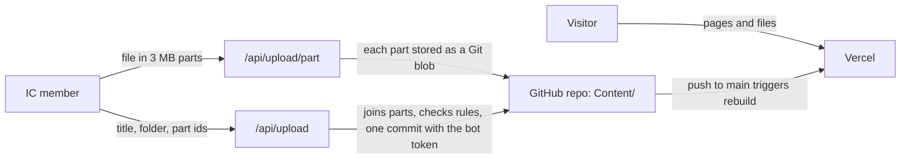

# ICDMS — Incubation Center Document Management System

One place for the NIT Patna Incubation Center's documents: policies, MoUs, reports, templates and event material. Built on the same logic as [ExamBlueprint](https://github.com/Harsh-Kapadiya/ExamBlueprint): the GitHub repository is the database, every file is a commit, and the site is rebuilt on every push.

**The difference: there are no admins.** Every IC member listed in `members.json` has the same rights.

| Who | Can |
|-----|-----|
| Anyone | Browse, search, view and download every file. No account needed. |
| IC members (official college email in `members.json`, signed in with Google) | Upload files. Their name is shown next to each file they add. |
| Anyone else who signs in | Nothing more than a visitor: Google sign-in is refused at the door. |
| Nobody, from the site | Replace or delete a file. Removal is done in GitHub by the repository owner, and every file stays recoverable from Git history. |

## How it works



In ExamBlueprint, admins uploaded with their own GitHub token. Uploaders here have no write access to the repo, so the server commits for them with one **bot token** that only it holds. Both upload routes check that the signed-in email is in `members.json`.

Vercel refuses any request body over 4.5 MB, so the browser sends each file in parts of up to 3 MB. Each part is stored as a Git blob (nothing changes on `main` yet); the final request joins the parts, checks the whole file, and commits it. Unused parts are cleaned up by GitHub's garbage collection.

### Content layout

```
members.json                        official college emails of IC members who may upload
Content/
├── catalog.json                    the folder list (edit in GitHub to add or rename folders)
└── reports/
    ├── annual-report-2026.pdf      the file
    └── annual-report-2026.pdf.json sidecar: { "title", "by", "at" } written by the upload route
```

### Adding or removing an IC member

Edit `members.json` in GitHub (one email per entry), and commit. The change applies after the next deploy, a minute or two later. Someone removed from the list loses upload access at that deploy, even if they are still signed in.

```json
{ "emails": ["harsh.k@nitp.ac.in", "asha.r@nitp.ac.in"] }
```

### Rules (`lib/rules.ts`, shared by the upload page, the upload route, the build and CI)

| Rule | Check |
|------|-------|
| File type | `.pdf`, `.docx`, `.pptx`, `.xlsx`, `.png`, `.jpg`, `.jpeg`, and the file's first bytes must match (a renamed file is refused) |
| Size | 10 MB or less |
| Name | Made from the uploader's title: lowercase letters, digits and hyphens, 3 to 80 characters |
| Folder | Must be listed in `Content/catalog.json`; no subfolders |
| Duplicates | Never overwritten. If the name is taken, the uploader is asked for a different title |
| Per submission | Up to 5 files, each saved as its own commit |
| Uploader | Signed in with Google, with an email listed in `members.json` |

PDFs and images open in the browser (View, and Preview on desktop). Word, PowerPoint and Excel files download.

## Setup

1. **Install:** Node.js 22.18 or newer, then `npm install`.
2. **Google sign-in:** follow [docs/google-oauth.md](docs/google-oauth.md), step by step. You get a client ID and secret.
3. **Bot token:** on GitHub, go to *Settings → Developer settings → Fine-grained personal access tokens → Generate new token*. Repository access: **only `Harsh-Kapadiya/ICDMS`**. Permissions: **Contents: Read and write**, nothing else. Set a reminder to renew it before it expires.
4. **Environment:** copy `.env.example` to `.env.local` and fill in `NEXTAUTH_SECRET` (`openssl rand -base64 32`), `GOOGLE_ID`, `GOOGLE_SECRET` and `GITHUB_UPLOAD_TOKEN`.
5. **Members:** replace the placeholder in `members.json` with the IC members' official college emails, starting with your own.
6. **Run:** `npm run dev`, then open http://localhost:3000. Local uploads commit to the real repo, so test with a throwaway file.
7. **Deploy:** import the repo in Vercel, add the same variables (with `NEXTAUTH_URL` set to the site's URL), and deploy. Every push to `main`, including each upload, redeploys the site in a minute or two.

## Checks

`npm run check` tests the rules, the members list and both upload routes against a fake GitHub (a 10 MB file sent in parts and joined back exactly, renamed files, path escapes, duplicates, two uploads at once), then validates everything in `Content/` and `members.json`. GitHub Actions runs it on every push, and a second workflow compresses newly uploaded PDFs.

## Known limits

- **`members.json` is public** while this repository is public: anyone can read the emails on GitHub. To keep them private, make the repository private; Vercel deploys private repositories the same way.
- **One commit per file:** a batch of 5 files is 5 commits, and can mean up to 5 deployments. Check your Vercel plan's daily deployment limit if uploads get busy.
- **Repository size:** keep an eye on it; past about 1 GB, move files to object storage (for example Supabase Storage).
- **Reporting a wrong file** goes through GitHub issues, which needs a GitHub account.

## Licence

See [LICENSE](LICENSE).
