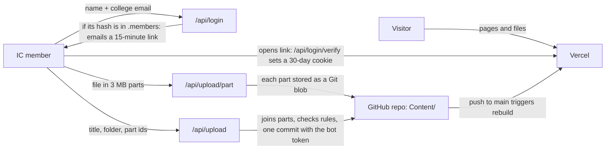

# ICDMS — Incubation Center Document Management System

One place for the NIT Patna Incubation Center's documents: policies, MoUs, reports, templates and event material. Built on the same logic as [ExamBlueprint](https://github.com/Harsh-Kapadiya/ExamBlueprint): the GitHub repository is the database, every file is a commit, and the site is rebuilt on every push.

**The difference: there are no admins.** Every IC member on the `.members` list has the same rights.

| Who | Can |
|-----|-----|
| Anyone | Browse, search, view and download every file. No account needed. |
| IC members (official college email on `.members`, signed in by an emailed link) | Upload files. Their name is shown next to each file they add. |
| Anyone else | Nothing more than a visitor: no sign-in link is ever sent to an email that isn't on the list. |
| Nobody, from the site | Replace or delete a file. Removal is done in GitHub by the repository owner, and every file stays recoverable from Git history. |

## How it works



In ExamBlueprint, admins uploaded with their own GitHub token. Uploaders here have no write access to the repo, so the server commits for them with one **bot token** that only it holds.

**Sign-in** needs no database and no Google account. The emailed link and the sign-in cookie are tokens signed with `AUTH_SECRET` (`lib/session.ts`), so only the server can make them. Both upload routes, and the upload page, check on every request that the signed-in email is still on `.members`. Setup, step by step: [docs/email-sign-in.md](docs/email-sign-in.md).

Vercel refuses any request body over 4.5 MB, so the browser sends each file in parts of up to 3 MB. Each part is stored as a Git blob (nothing changes on `main` yet); the final request joins the parts, checks the whole file, and commits it. Unused parts are cleaned up by GitHub's garbage collection.

### Content layout

```
.members                            IC members who may upload: one hashed college email per line
Content/
├── catalog.json                    the folder list (edit in GitHub to add or rename folders)
└── reports/
    ├── annual-report-2026.pdf      the file
    └── annual-report-2026.pdf.json sidecar: { "title", "by", "at" } written by the upload route
```

### Adding or removing an IC member

`.members` stores each email only as a SHA-256 hash, so people browsing the repository can't read the list. Don't edit it by hand; use the script, then commit and push:

```
npm run add-member asha.r@nitp.ac.in            add one or more members
npm run add-member -- --find asha.r@nitp.ac.in  print someone's line, to delete it when they leave
```

Changes apply after the next deploy, a minute or two later. Someone removed loses upload access at that deploy, even if they are still signed in. The site checks an email by hashing what was typed, so anyone who already knows an exact address could still test whether it is on the list.

### Rules (`lib/rules.ts`, shared by the upload page, the upload route, the build and CI)

| Rule | Check |
|------|-------|
| File type | `.pdf`, `.docx`, `.pptx`, `.xlsx`, `.png`, `.jpg`, `.jpeg`, and the file's first bytes must match (a renamed file is refused) |
| Size | 10 MB or less |
| Name | Made from the uploader's title: lowercase letters, digits and hyphens, 3 to 80 characters |
| Folder | Must be listed in `Content/catalog.json`; no subfolders |
| Duplicates | Never overwritten. If the name is taken, the uploader is asked for a different title |
| Per submission | Up to 5 files, each saved as its own commit |
| Uploader | Signed in through an emailed link, with an email on `.members` |

PDFs and images open in the browser (View, and Preview on desktop). Word, PowerPoint and Excel files download.

## Setup

1. **Install:** Node.js 22.18 or newer, then `npm install`.
2. **Email sign-in:** follow [docs/email-sign-in.md](docs/email-sign-in.md), step by step: a Gmail app password for sending, `AUTH_SECRET`, and `SITE_URL`.
3. **Bot token:** on GitHub, go to *Settings → Developer settings → Fine-grained personal access tokens → Generate new token*. Repository access: **only `Harsh-Kapadiya/ICDMS`**. Permissions: **Contents: Read and write**, nothing else. Set a reminder to renew it before it expires.
4. **Environment:** copy `.env.example` to `.env` and fill it in. With `SMTP_HOST` left empty, sign-in links are printed in the terminal instead of emailed, which is enough to try the site.
5. **Members:** `npm run add-member your.name@nitp.ac.in`, then the other IC members.
6. **Run:** `npm run dev`, then open http://localhost:3000. Local uploads commit to the real repo, so test with a throwaway file.
7. **Deploy:** import the repo in Vercel, add the same variables (with `SITE_URL` set to the site's address), and deploy. Every push to `main`, including each upload, redeploys the site in a minute or two.

## Checks

`npm run check` tests the rules, member hashing, sign-in tokens (forged, expired, or a link used as a cookie) and both upload routes against a fake GitHub (a 10 MB file sent in parts and joined back exactly, renamed files, path escapes, duplicates, two uploads at once), then validates everything in `Content/` and `.members`. GitHub Actions runs it on every push, and a second workflow compresses newly uploaded PDFs.

## Known limits

- **Sign-in emails:** a free Gmail account sends about 500 a day. There is no rate limit on the sign-in form, so someone could make a member's inbox receive repeated links; add a Vercel firewall rule if that happens.
- **One commit per file:** a batch of 5 files is 5 commits, and can mean up to 5 deployments. Check your Vercel plan's daily deployment limit if uploads get busy.
- **Repository size:** keep an eye on it; past about 1 GB, move files to object storage (for example Supabase Storage).
- **Reporting a wrong file** goes through GitHub issues, which needs a GitHub account.

## Licence

See [LICENSE](LICENSE).
