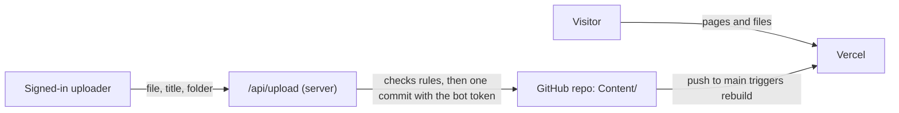

# ICDMS — Incubation Center Document Management System

One place for the NIT Patna Incubation Center's documents: policies, MoUs, reports, templates and event material. Built on the same logic as [ExamBlueprint](https://github.com/Harsh-Kapadiya/ExamBlueprint): the GitHub repository is the database, every file is a commit, and the site is rebuilt on every push.

**The difference: there are no admins.**

| Who | Can |
|-----|-----|
| Anyone | Browse, search, view and download every file. No account needed. |
| Anyone signed in with Google | Upload files. Their name is shown next to each file they add. |
| Nobody, from the site | Replace or delete a file. Removal is done in GitHub by the repository owner, and every file stays recoverable from Git history. |

## How it works



In ExamBlueprint, admins uploaded with their own GitHub token. Visitors here have no write access to the repo, so the server commits for them with one **bot token** that only it holds. Because files pass through the server, Vercel's 4.5 MB request limit sets the file limit to **4 MB**.

### Content layout

```
Content/
├── catalog.json                    the folder list (edit in GitHub to add or rename folders)
└── reports/
    ├── annual-report-2026.pdf      the file
    └── annual-report-2026.pdf.json sidecar: { "title", "by", "at" } written by the upload route
```

### Rules (`lib/rules.ts`, shared by the upload page, the upload route, the build and CI)

| Rule | Check |
|------|-------|
| File type | `.pdf`, `.docx`, `.pptx`, `.xlsx`, `.png`, `.jpg`, `.jpeg`, and the file's first bytes must match (a renamed file is refused) |
| Size | 4 MB or less |
| Name | Made from the uploader's title: lowercase letters, digits and hyphens, 3 to 80 characters |
| Folder | Must be listed in `Content/catalog.json`; no subfolders |
| Duplicates | Never overwritten. If the name is taken, the uploader is asked for a different title |
| Per submission | Up to 10 files, each saved as its own commit |

PDFs and images open in the browser (View, and Preview on desktop). Word, PowerPoint and Excel files download.

## Setup

1. **Install:** Node.js 22.18 or newer, then `npm install`.
2. **Google sign-in:** in [Google Cloud Console](https://console.cloud.google.com/apis/credentials), create an OAuth client ID of type *Web application*. Add the redirect URIs `http://localhost:3000/api/auth/callback/google` and `https://<your-site>/api/auth/callback/google`. Copy the client ID and secret.
3. **Bot token:** on GitHub, go to *Settings → Developer settings → Fine-grained personal access tokens → Generate new token*. Repository access: **only `Harsh-Kapadiya/ICDMS`**. Permissions: **Contents: Read and write**, nothing else. Set a reminder to renew it before it expires.
4. **Environment:** copy `.env.example` to `.env.local` and fill in `NEXTAUTH_SECRET` (`openssl rand -base64 32`), `GOOGLE_ID`, `GOOGLE_SECRET` and `GITHUB_UPLOAD_TOKEN`.
5. **Run:** `npm run dev`, then open http://localhost:3000. Local uploads commit to the real repo, so test with a throwaway file.
6. **Deploy:** import the repo in Vercel, add the same variables (with `NEXTAUTH_URL` set to the site's URL), and deploy. Every push to `main`, including each upload, redeploys the site in a minute or two.

## Checks

`npm run check` tests the rules and the upload route against a fake GitHub (valid files, renamed files, path escapes, duplicates, two uploads at once), then validates everything in `Content/`. GitHub Actions runs it on every push, and a second workflow compresses newly uploaded PDFs.

## Known limits

- **Spam:** anyone with a Google account can upload. If it becomes a problem, limit sign-in to institute emails with a `signIn` callback in `lib/auth.ts`.
- **One commit per file:** a batch of 10 files is 10 commits, and can mean up to 10 deployments. Check your Vercel plan's daily deployment limit if uploads get busy.
- **Repository size:** keep an eye on it; past about 1 GB, move files to object storage (for example Supabase Storage).
- **Reporting a wrong file** goes through GitHub issues, which needs a GitHub account.

## Licence

See [LICENSE](LICENSE).
